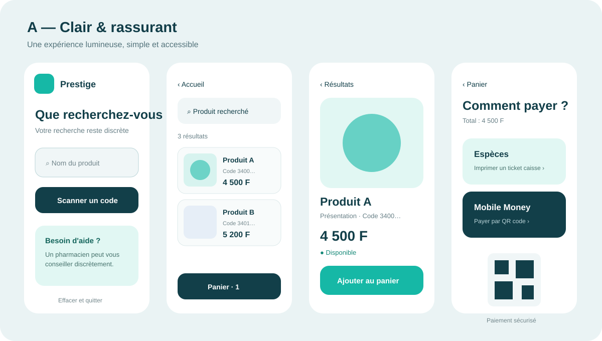
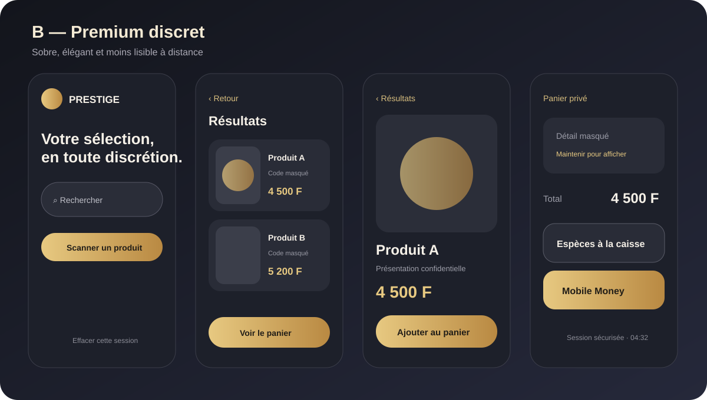
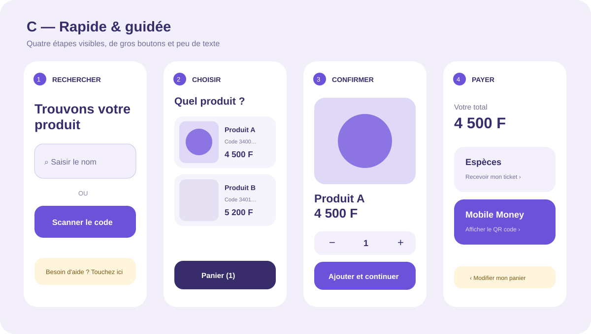

# Vente mobile confidentielle — propositions UX et spécification fonctionnelle

> **Statut :** document de cadrage à valider  
> **Objectif :** permettre à un client de rechercher, choisir et payer un produit depuis une borne ou un mobile, sans avoir à annoncer oralement son achat au comptoir.  
> **Important :** la discrétion de l'interface ne remplace pas les obligations de conseil, de contrôle, de délivrance ou de vente applicables aux produits concernés.

## 1. Résumé du parcours

Le client démarre depuis une page d'accueil simple et accueillante. Il saisit le nom d'un produit dans une recherche dynamique. Les résultats présentent le code, le nom, le prix et l'image. Il ouvre ensuite une fiche produit, choisit une quantité, puis ajoute le produit à son panier.

À tout moment, il peut :

- revenir à la liste des résultats sans perdre sa recherche ;
- corriger la quantité ou retirer un article ;
- poursuivre ses achats ;
- abandonner la session et effacer immédiatement ses données locales.

À la fin :

- **paiement en espèces :** la borne imprime un ticket de réservation anonyme à présenter à la caisse ;
- **Mobile Money :** le client choisit l'opérateur, puis scanne un QR code de paiement à usage unique ;
- après confirmation ou annulation, l'application efface la session et revient automatiquement à l'accueil.

---

## 2. Trois présentations modernes proposées

Les maquettes suivantes sont des orientations visuelles. Elles ne représentent pas encore le design final ni les couleurs définitives de Prestige.

### Proposition A — « Clair & rassurant » — recommandée



**Principes**

- fond très clair et cartes blanches ;
- une seule action principale par écran ;
- recherche immédiatement visible ;
- grandes images produit et prix très lisible ;
- palette bleu nuit, turquoise et blanc inspirant confiance ;
- excellent compromis entre discrétion, accessibilité et environnement officinal.

**À choisir si :** la borne doit convenir à tous les âges et rester immédiatement compréhensible.

### Proposition B — « Premium discret »



**Principes**

- fond sombre élégant ;
- contraste élevé ;
- cartes produit aérées ;
- contenu confidentiel moins visible à distance ;
- expérience proche d'une application mobile premium.

**À choisir si :** la discrétion visuelle et le positionnement haut de gamme sont prioritaires.

### Proposition C — « Rapide & guidée »



**Principes**

- parcours découpé en quatre étapes visibles ;
- très gros boutons ;
- messages courts ;
- panier toujours accessible ;
- usage adapté aux écrans de borne et aux personnes peu habituées au numérique.

**À choisir si :** la vitesse d'exécution et l'accompagnement pas à pas sont prioritaires.

### Comparaison rapide

| Critère | A — Clair & rassurant | B — Premium discret | C — Rapide & guidée |
|---|---:|---:|---:|
| Facilité de prise en main | Excellente | Bonne | Excellente |
| Discrétion à distance | Bonne | Excellente | Bonne |
| Accessibilité seniors | Excellente | Moyenne à bonne | Excellente |
| Image moderne | Excellente | Excellente | Très bonne |
| Densité d'information | Équilibrée | Faible | Très faible |
| Recommandation | **Choix par défaut** | Variante premium | Variante borne assistée |

---

## 3. Parcours détaillé

### Écran 1 — Accueil

L'accueil ne doit présenter aucune catégorie pouvant révéler le motif d'achat. Il affiche :

- le logo de l'officine ou Prestige ;
- un message neutre : **« Que recherchez-vous ? »** ;
- un grand champ de recherche ;
- un bouton microphone uniquement si la confidentialité sonore peut être garantie ;
- une option **« Scanner un code »** ;
- un accès au panier ;
- un bouton permanent **« Effacer et quitter »**.

Le clavier virtuel s'ouvre dès que le client touche la recherche. Sur mobile, le clavier natif est utilisé.

### Écran 2 — Recherche dynamique

La recherche commence après **deux caractères** et après une temporisation de 250 à 350 ms afin d'éviter un appel serveur à chaque frappe.

Chaque résultat contient :

- image du produit ou visuel générique neutre ;
- nom commercial ;
- présentation ou dosage si cette information peut être affichée ;
- code CIP/EAN selon le paramétrage ;
- prix TTC ;
- disponibilité prudente : `Disponible`, `À confirmer` ou `Indisponible` ;
- bouton **« Voir »**.

Les résultats peuvent être filtrés et triés, mais aucun historique nominatif ne doit apparaître.

### Écran 3 — Fiche produit

La fiche affiche clairement :

- image principale ;
- nom et présentation ;
- prix unitaire TTC ;
- disponibilité ;
- informations essentielles ;
- quantité avec boutons `−` et `+` ;
- bouton **« Ajouter au panier »** ;
- bouton **« Retour aux résultats »**.

Si le produit nécessite un conseil, une validation ou une délivrance spécifique, l'écran remplace l'ajout direct par :

- **« Demander l'assistance confidentielle d'un pharmacien »**, ou
- **« Ajouter à la demande — validation au comptoir requise »**.

L'interface ne doit jamais présenter un produit comme approprié au client sur la seule base de sa recherche.

### Écran 4 — Confirmation d'ajout

Pour ne pas interrompre le parcours :

- une confirmation brève apparaît pendant environ deux secondes ;
- le panier se met à jour ;
- le client peut choisir **« Continuer mes achats »** ou **« Voir mon panier »** ;
- il reste sur la fiche ou revient à sa recherche selon son choix.

### Écran 5 — Panier

Pour chaque ligne : image, nom, prix unitaire, quantité, sous-total, modification et suppression.

Le récapitulatif affiche :

- nombre d'articles ;
- total TTC ;
- éventuels produits nécessitant une validation ;
- bouton **« Continuer mes achats »** ;
- bouton **« Choisir le paiement »**.

Le serveur recalcule toujours le prix et la disponibilité avant le passage au paiement.

### Écran 6 — Choix du paiement

Deux grandes cartes sont proposées :

1. **Espèces à la caisse** ;
2. **Mobile Money**.

Le client doit confirmer le total avant de poursuivre.

### Écran 7A — Espèces

Prestige crée une réservation temporaire et imprime un ticket comportant :

- un numéro court et un QR code interne ;
- la date et l'heure ;
- le total indicatif ;
- la durée de validité ;
- la mention **« À régler à la caisse — ceci n'est pas un reçu de paiement »**.

Pour préserver la confidentialité, la configuration recommandée n'imprime pas les noms des produits. Le détail reste accessible à la caisse après lecture du QR code. Une option réglementaire peut imposer le détail si nécessaire.

Si l'imprimante ne répond pas, aucun ticket ne doit être déclaré imprimé. L'écran propose une nouvelle tentative ou un code court à communiquer discrètement à la caisse.

### Écran 7B — Mobile Money

Le client sélectionne un opérateur parmi ceux activés pour l'officine. Prestige demande alors au prestataire de paiement une transaction :

- d'un montant fixé côté serveur ;
- liée à un identifiant de commande unique ;
- avec une date d'expiration courte ;
- non réutilisable.

Le QR code affiché ne doit jamais contenir un simple numéro de téléphone accompagné d'un montant librement modifiable. Il doit représenter une demande de paiement vérifiable.

L'écran affiche :

- opérateur sélectionné ;
- montant ;
- QR code ;
- temps restant ;
- état `En attente`, `Confirmé`, `Expiré` ou `Échec` ;
- bouton **« Changer de mode de paiement »**.

Prestige considère le paiement comme réussi uniquement après confirmation serveur signée du prestataire, jamais sur la base d'une capture d'écran ou du seul retour du navigateur.

### Écran 8 — Fin de session

Après paiement confirmé ou émission correcte du ticket :

1. afficher une confirmation pendant quelques secondes ;
2. proposer l'impression d'un justificatif si nécessaire ;
3. fermer le panier ;
4. supprimer les données de session de l'écran ;
5. réinitialiser le clavier et l'historique ;
6. revenir automatiquement à l'accueil.

En l'absence d'activité, un avertissement apparaît avant expiration puis la session est automatiquement effacée.

---

## 4. Contrôles de saisie et règles de validation

### Recherche

| Champ/événement | Contrôle | Réponse utilisateur |
|---|---|---|
| Terme vide | Interdire la recherche | « Saisissez au moins 2 caractères » |
| Un seul caractère | Ne pas interroger le serveur | Aucun message agressif ; aide discrète |
| Espaces répétés | Normaliser | Correction automatique |
| Texte très long | Limiter, par exemple à 100 caractères | Compteur ou blocage doux |
| Caractères spéciaux | Autoriser ceux utiles aux noms ; neutraliser côté serveur | Aucun code exécuté ou interprété |
| Réponse lente | Afficher un squelette de chargement | Boutons non bloqués inutilement |
| Aucun résultat | Proposer correction, scan ou demande discrète d'aide | Ne pas afficher une page vide |
| Double clic | Dédupliquer la requête | Un seul résultat d'action |

La recherche côté serveur doit être paramétrée, protégée contre les injections et limiter le nombre de résultats retournés.

### Produit et quantité

| Règle | Contrôle attendu |
|---|---|
| Produit actif | Refuser un produit supprimé ou désactivé |
| Prix valide | Recalculer depuis le serveur, ne jamais faire confiance au prix affiché par le mobile |
| Disponibilité | Recontrôler à l'ajout puis au paiement |
| Quantité | Entier strictement positif |
| Maximum | Limite configurable par produit et par transaction |
| Décrément | Ne jamais descendre sous 1 ; proposer « Retirer » séparément |
| Vente contrôlée | Imposer la validation prévue par les règles métier |
| Images | Format et taille contrôlés ; visuel neutre de remplacement |
| Ajout répété | Fusionner la ligne ou expliquer clairement le cumul |

### Panier

- recalculer le total côté serveur ;
- vérifier les prix modifiés depuis l'ajout ;
- signaler un produit devenu indisponible ;
- empêcher une quantité négative, nulle, décimale ou excessive ;
- empêcher les validations multiples par double appui ;
- utiliser une clé d'idempotence pour chaque validation ;
- afficher tout changement avant paiement et demander confirmation.

### Paiement espèces

- vérifier que le panier n'est pas vide ;
- réserver un identifiant unique ;
- empêcher l'impression multiple involontaire ;
- distinguer `ticket créé`, `impression demandée`, `imprimé` et `payé en caisse` ;
- expirer automatiquement un ticket non payé ;
- ne décrémenter définitivement le stock qu'au moment défini par la politique de l'officine.

### Paiement Mobile Money

- vérifier que l'opérateur est actif ;
- prendre le montant depuis le serveur ;
- contrôler les minimums et maximums ;
- signer et authentifier les échanges ;
- fixer une expiration ;
- rendre la demande idempotente ;
- vérifier la signature du callback ;
- rapprocher montant, devise, commande et transaction ;
- ignorer un callback dupliqué ;
- gérer l'état incertain sans créer deux ventes ;
- prévoir annulation, expiration, remboursement et rapprochement comptable.

### Session et retour à l'accueil

- compte à rebours d'inactivité configurable ;
- avertissement avant fermeture ;
- effacement du panier local et des résultats ;
- invalidation du jeton de session ;
- aucun bouton « Retour » ne doit révéler la session précédente ;
- aucune donnée sensible dans l'URL ;
- retour automatique même après erreur terminale, avec journal technique non visible du client suivant.

---

## 5. Confidentialité dès la conception

La promesse doit être formulée comme une **expérience discrète**, et non comme un anonymat absolu : la délivrance, le paiement, la réglementation ou la sécurité peuvent nécessiter une intervention ou une identification.

### Mesures recommandées

- filtre de confidentialité physique sur l'écran de borne ;
- orientation de l'écran évitant la visibilité depuis la file d'attente ;
- aucune suggestion personnelle sur l'accueil ;
- aucun historique des clients précédents ;
- noms de produits masqués sur le ticket de réservation par défaut ;
- session courte et effacement automatique ;
- aucune capture dans les journaux applicatifs ;
- données de recherche conservées seulement si une politique explicite et une base légitime le permettent ;
- bouton **« Effacer et quitter »** visible en permanence ;
- notifications sonores neutres ;
- assistance humaine demandée au moyen d'un message discret.

### Réduction de l'exposition visuelle

Un mode **« écran discret »** peut masquer temporairement les images et noms de produits dans le panier. Le client les révèle avec un appui maintenu. Cette option est particulièrement pertinente pour la proposition B.

---

## 6. Accessibilité et ergonomie

- zones tactiles d'au moins 44 × 44 px ;
- contraste suffisant ;
- taille de texte réglable ;
- navigation au clavier pour une borne accessible ;
- libellés explicites, jamais uniquement des icônes ;
- lecteur d'écran pris en charge ;
- focus visible ;
- messages d'erreur associés au bon champ ;
- prix lisibles sans ambiguïté ;
- français simple, avec langues supplémentaires configurables ;
- animation réduite si le terminal ou l'utilisateur le demande.

---

## 7. États à prévoir pour chaque écran

Chaque écran doit être conçu et testé dans les états suivants :

- initial ;
- chargement ;
- succès ;
- vide ;
- erreur récupérable ;
- indisponibilité réseau ;
- session expirée ;
- double action ;
- données devenues obsolètes ;
- périphérique indisponible, notamment caméra ou imprimante.

Un écran moderne n'est pas seulement son état idéal : les états d'attente et d'erreur doivent être tout aussi soignés.

---

## 8. Modèle fonctionnel minimal

```text
shopping_session
  id, terminal_id, status, created_at, expires_at

shopping_cart
  id, session_id, version, status, total

shopping_cart_item
  id, cart_id, product_id, quantity, unit_price_snapshot

checkout
  id, cart_id, payment_method, status, idempotency_key

payment_attempt
  id, checkout_id, provider, external_reference,
  amount, currency, status, expires_at

cash_ticket
  id, checkout_id, public_short_code, status, expires_at

checkout_audit
  id, checkout_id, event_type, created_at, technical_metadata
```

Les données de paiement sensibles ne doivent pas être stockées directement dans Prestige. La référence technique du prestataire suffit dans la majorité des cas.

---

## 9. Scénarios de test d'acceptation

### Accueil et recherche

1. La page s'affiche sans données du client précédent.
2. Deux caractères déclenchent une recherche dynamique.
3. Une faute simple produit des suggestions utiles.
4. Un produit sans image utilise le visuel générique.
5. Une coupure réseau permet de réessayer sans perdre toute la session.
6. Les caractères spéciaux ne cassent pas l'interface et ne déclenchent aucun script.

### Fiche produit et panier

1. Le retour conserve le terme de recherche et la position dans la liste.
2. Deux appuis rapides n'ajoutent pas deux fois involontairement.
3. La quantité ne peut pas être nulle ou négative.
4. Un prix modifié est signalé avant le paiement.
5. Un produit devenu indisponible ne peut pas être payé silencieusement.
6. Un produit soumis à validation déclenche le parcours approprié.

### Espèces

1. Un ticket unique est créé pour un panier validé.
2. Le ticket est lisible par la caisse.
3. Il est clairement indiqué qu'il ne constitue pas une preuve de paiement.
4. Une panne d'imprimante ne produit pas un faux succès.
5. Un ticket expiré est refusé ou réactivé selon une procédure contrôlée.

### Mobile Money

1. Le QR code correspond exactement au montant serveur.
2. Un paiement confirmé une seule fois crée une seule vente.
3. Deux callbacks identiques ne créent pas de doublon.
4. Un callback signé mais portant un mauvais montant est rejeté.
5. Un QR expiré ne peut pas valider la commande.
6. Le client peut revenir au choix du paiement avant confirmation.
7. Une confirmation retardée est rapprochée sans double encaissement.

### Confidentialité et session

1. L'expiration efface l'écran et le panier local.
2. Le bouton précédent du navigateur ne restaure pas les produits.
3. Le ticket discret ne montre pas le détail par défaut.
4. Les journaux ne contiennent pas le contenu des recherches.
5. « Effacer et quitter » revient immédiatement à l'accueil.

---

## 10. Indicateurs de réussite

- temps médian entre l'accueil et le premier ajout ;
- taux de recherches sans résultat ;
- taux d'abandon par écran ;
- temps moyen de paiement ;
- échecs d'impression ;
- paiements expirés ou incertains ;
- demandes d'assistance ;
- écarts de prix ou de disponibilité ;
- retour automatique correct à l'accueil ;
- incidents de confidentialité signalés.

Les statistiques doivent être agrégées et conçues pour éviter la constitution inutile d'un historique d'achats sensibles.

---

## 11. Décisions à valider avant développement

1. Choisir la direction visuelle **A, B ou C**, ou demander une combinaison.
2. Déterminer si le support initial est une borne, un téléphone personnel ou les deux.
3. Définir les catégories vendables sans intervention et celles exigeant un pharmacien.
4. Choisir les opérateurs Mobile Money et obtenir leurs API de paiement marchand.
5. Définir le moment exact de réservation et de décrément du stock.
6. Valider le contenu légal et comptable du ticket espèces.
7. Fixer la durée d'inactivité et la durée de validité du ticket.
8. Valider la politique de conservation des recherches, paniers abandonnés et audits.

## 12. Recommandation de MVP

Pour livrer rapidement sans fragiliser l'encaissement :

1. adopter la **proposition A** ;
2. livrer accueil, recherche, fiche produit, panier et ticket espèces ;
3. intégrer d'abord un seul opérateur Mobile Money dans un environnement de test ;
4. mettre en place l'idempotence, l'expiration et le rapprochement avant la production ;
5. tester la borne avec de vrais clients volontaires ;
6. ajouter ensuite le mode discret premium et d'autres opérateurs.

Le critère principal doit être : **un nouveau client comprend quoi faire en moins de cinq secondes et peut terminer sans exposer inutilement son achat.**
